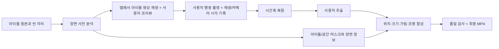

# "함께 촬영" 영상 합성 기능 설계안

작성일: 2026-09-22  
상태: 구현 전 설계안

## 1. 목표와 입력 조건

사전 촬영된 영상에는 **아이돌 한 명과 사용자가 들어갈 빈 자리**가 있다. 사용자는 앱에서 아이돌 영상을 보면서 그 자리에 맞춰 원하는 행동을 직접 촬영한다. 손하트, 하이파이브, 나란히 춤추기처럼 행동 종류는 제한하지 않는다. 결과 영상은 원본 아이돌의 행동과 사용자가 실제로 촬영한 행동을 같은 장면에 배치한다.

이 기능의 핵심은 사용자의 행동을 추측하거나 생성하는 것이 아니다. **촬영 시점에 사용자가 본 아이돌 프레임과 실제 카메라 프레임의 대응 관계를 보존하고, 사용자를 원본 장면에 자연스럽게 합성하는 것**이다. 동작별 분기, 아이돌과 사용자 포즈의 유사도 검색, 사용자의 팔·손 동작 생성은 요구하지 않는다.

성공 조건은 다음과 같다.

1. 원본 아이돌의 픽셀과 행동을 유지한다.
2. 사용자가 한 행동의 순서, 속도, 방향을 유지한다.
3. 두 영상이 같은 시각에 진행되고, 사용자 크기·위치·조명·가림이 자연스럽다.
4. 접촉 장면은 실제 촬영에서 가까운 손이나 신체 부위를 **작은 범위에서만** 맞춘다. 맞출 수 없는 장면은 허위 접촉을 만들지 않는다.

## 2. 현재 코드에서 확인한 사실

| 현재 경로 | 역할 | 이 기능에서의 판단 |
|---|---|---|
| [`service.py`](../service.py)의 `_choose_people`, `process_video` | 사전계산된 **두 사람 이상**의 배경에서 한 사람을 제거하고 나머지 한 사람을 기준 인물로 선택 | 서비스 흐름은 새 기능에 직접 적용할 수 없음. S3 다운로드·결과 업로드·무결성 검증 패턴은 활용 가능 |
| [`source/service/prepost.py`](../source/service/prepost.py)의 `run_post`, `postprocess` | 음악 구간 선택 → 사용자 추출 → 기준 인물 포즈 보정 → 제거 위치 배치 → 가림·조명·합성 | 단계 일부는 활용 가능하나 `remove_id`, `driver_id`, 제거된 사람의 마스크·특징량에 묶여 있으므로 새 실행 경로가 필요 |
| [`source/enhancement/correction.py`](../source/enhancement/correction.py) | 기준 인물과 사용자 포즈를 DTW로 맞추고 작은 2D 관절 변형을 적용 | 새 기능의 기본 경로에서 제외. 서로 다른 보완 동작을 같은 포즈로 맞추면 사용자 의도가 훼손됨 |
| [`source/enhancement/correction_worker.py`](../source/enhancement/correction_worker.py) | DWPose 결과 중 몸 관절 18개를 저장 | 손 접촉을 분석하려면 손 관절 추출 경로를 별도로 연결해야 함. 현 결과에 손 관절이 있다고 가정하면 안 됨 |
| `pipeline.export_isolated_crop`, [`edge_matte.py`](../source/enhancement/edge_matte.py) | 사용자 추적·RGBA 추출·경계 보정 | 재사용 후보. 새 시간축과 한 사람 입력 조건으로 검증 필요 |
| [`geometry_placement.py`](../source/enhancement/geometry_placement.py), [`depth_occlusion.py`](../source/enhancement/depth_occlusion.py) | 제거된 인물 자리와 A/B 마스크를 기준으로 배치·가림 계산 | 알고리즘 일부는 참고할 수 있지만 기존 함수 입력 계약은 맞지 않음. 빈 자리용 배치·아이돌/사용자 가림 판단을 새로 구성 |
| [`composite.py`](../source/relighting/composite.py), [`variants.py`](../source/relighting/variants.py) | RGBA 객체 렌더, 합성, RelightVid 조명·그림자 | 렌더링 부품은 재사용 후보. RelightVid 준비 함수는 제거 인물 마스크를 받으므로 단독 아이돌 장면으로 검증·적응 필요 |

현재 `match_segment`는 음악을 맞추면서 배경 구간을 자를 수 있다. 사용자가 **어느 아이돌 프레임을 보며 촬영했는지** 아는 새 기능에서는 촬영 메타데이터의 시간 대응이 우선이다. 음악 매칭은 별도 기기로 촬영한 입력을 복구하는 보조 경로로만 고려한다.

## 3. 권장 제품 흐름



### 3.1 아이돌 영상 준비

아이돌 영상마다 다음 정보를 사전 계산한다. 이는 **행동별 로직**이 아니라 모든 영상에 같은 분석기를 적용한 결과다.

- 원본 프레임의 표시 시각(PTS), 해상도·회전·색 공간·오디오 정보.
- 아이돌의 인물 마스크, 몸 관절, 필요할 때 손 관절의 프레임별 궤적과 신뢰도.
- 사용자 배치 가능 영역. 빈 공간이 고정이면 하나의 영역으로 충분하고, 카메라가 움직이거나 아이돌이 이동하면 시간에 따라 변하는 영역으로 저장한다.
- 바닥/발 위치, 아이돌의 화면상 키, 카메라 움직임 등 **얻을 수 있는** 장면 정보. 확신이 낮은 값은 `unknown`으로 남긴다.
- 원본 영상과 분석 결과의 버전·해시. 사전 분석 결과를 다시 사용할 때 다른 원본과 섞이지 않도록 확인한다.

아이돌이 혼자 촬영한 영상이므로 사람 제거와 배경 인페인팅은 이 기능의 기본 요구가 아니다. 빈자리가 실제로 영상에 충분히 존재하는지 사전 검사한다.

### 3.2 앱 촬영

**가장 영향이 큰 신규 기능은 촬영 앱의 동기화와 프레이밍이다.** 사용자가 영상을 보면서 행동한다는 사실만으로, 저장된 사용자 MP4의 0초가 아이돌 영상 0초와 같아지지는 않는다. 재생 시작 지연, 화면 표시 지연, 카메라 노출·인코딩 지연, 일시정지와 프레임 누락이 생긴다.

앱은 다음을 제공한다.

1. 아이돌 영상과 사용자 카메라 프리뷰를 함께 보여준다. 빈 자리의 위치·크기와 발 위치를 가이드로 표시한다. 프런트 카메라의 **거울 프리뷰와 실제 저장 영상의 좌우 방향 차이**를 같은 출력 좌표계로 정리한다.
2. 하나의 촬영 세션에서 재생 상태와 카메라 캡처 시각을 기록한다. 각 표시된 아이돌 프레임의 `base_media_time`과 같은 기준 시계의 `display_time`, 사용자 프레임의 `capture_time` 또는 원본 PTS를 남긴다. 재생 정지·탐색·프레임 누락도 기록한다.
3. 영상과 시각 메타데이터를 한 세션 ID로 묶어 업로드한다. 촬영 중 화면 녹화본을 사용자 영상 대신 사용하지 않는다.
4. 최종 오디오는 아이돌 원본을 기본으로 사용한다. 사용자 음성이 필요하면 녹음/믹싱 정책을 별도로 정하고, 재생 소리가 마이크에 다시 들어가는지 검사한다.

웹에서는 [`requestVideoFrameCallback`](https://developer.mozilla.org/en-US/docs/Web/API/HTMLVideoElement/requestVideoFrameCallback)의 `mediaTime`과 표시 예상 시각을 사용할 수 있지만, 콜백 시각만으로 실제 화면 표시를 정확히 보장하지 않는다. 네이티브 카메라도 기기별 캡처 타임스탬프의 시계 원점을 확인해야 한다. 예를 들어 Android의 [`SENSOR_TIMESTAMP`](https://developer.android.com/reference/android/hardware/camera2/CaptureResult#SENSOR_TIMESTAMP)는 timestamp source 설정에 따라 다른 서브시스템 시계와 비교 가능 여부가 달라진다. 따라서 **한 기준 시계로 변환된 기록 또는 앱이 측정한 시계 대응값**을 계약에 포함한다.

### 3.3 시간축 복원

출력 프레임 `i`의 아이돌 표시 시각을 `t_base[i]`라고 할 때, 촬영 기록으로 `t_user[i] = sync_map(t_base[i])`를 계산하고 해당 시각의 사용자 프레임을 가져온다. `sync_map`은 표시 시각과 캡처 시각의 대응점 사이에서 단조 보간한다. 시각 기록이 일정하고 드리프트가 작다면 `t_user = a × t_base + b`로 충분하다. 일시정지·탐색·긴 누락이 있으면 해당 구간은 억지로 이어 붙이지 않고 재촬영 또는 구간 제외로 처리한다.

- 원본 영상의 프레임 번호만으로 시간을 계산하지 말고 실제 PTS를 기준으로 한다. 가변 프레임률(VFR) 촬영을 허용한다.
- 사용자 행동을 아이돌 포즈에 맞추는 DTW·미러링·국소 시간 늘리기를 자동 적용하지 않는다. 사용자가 동작 시점을 조정한 촬영 의도를 유지한다.
- 최초 촬영에서는 별도 기준 신호(화면 플래시, 오디오 큐 등)와 저장된 프레임을 비교해 **전체 시간 오프셋을 보정할 수 있는 값**을 측정한다. 플랫폼 지연이 일정하다는 가정만으로 운영하지 않는다.
- 시간 대응 신뢰도가 낮으면 합성 전에 사용자에게 수동 오프셋 미리보기 또는 재촬영을 제공한다. 정밀 접촉을 후처리만으로 보장할 수 없다.

### 3.4 사용자 추출과 원본 행동 보존

기존 추적·격리 기능으로 사용자 한 명을 선택하고, 프레임별 RGBA와 알파 마스크를 만든다. 손가락, 머리카락, 빠르게 움직이는 팔에서 경계가 흔들리므로 기존 `edge_matte`를 적용하고 시간적으로 검사한다. 여러 사람이 찍히거나 손·발이 프레임 밖으로 나가면 사용자가 즉시 재촬영할 수 있게 이유를 반환한다.

이 경로의 입력은 **사용자 실제 프레임**이고 출력도 같은 자세의 사용자 프레임이다. 기본적으로 관절 변형, 포즈 생성, 손 모양 생성은 없다. 축소·이동·색/조명 보정·알파 경계 처리만 수행한다.

### 3.5 배치와 카메라 일치

배치기는 시간 `t`마다 사용자 RGBA를 아이돌 원본 좌표계로 보내는 변환 `T(t)`를 구한다. 처음에는 **하나의 인물에 대한 2D 크기·이동**으로 시작하고, 카메라 관점 차이가 큰 장면은 촬영 가이드나 자산 제한으로 처리한다.

입력 근거의 우선순위는 다음과 같다.

1. 앱 프리뷰에서 사용자가 보며 맞춘 위치와 크기, 저장 영상의 거울/회전 정보.
2. 사전 분석된 빈 자리, 화면 경계, 바닥선 및 발 위치.
3. 아이돌과 사용자의 몸 크기·카메라 이동 추정. 이는 2D 추정치이므로 절대 거리로 취급하지 않는다.
4. 접촉이 예상되는 짧은 구간의 관절 위치. 이 근거만으로 인물 전체를 크게 움직이지 않는다.

목표는 사용자가 빈 자리 안에 들어가고 발·몸 크기가 장면과 어울리며 프레임 사이에서 튀지 않는 것이다. 변환은 시간적으로 부드럽게 하되 실제 사용자 이동까지 지워서는 안 된다. 가이드에 맞춰 촬영했으면 거의 고정된 변환이 가장 안정적이다. 카메라가 이동하면 아이돌 장면의 카메라 움직임을 반영한다.

빈 자리나 프리뷰 좌표를 벗어나게 되는 경우, 사용자 몸을 심하게 압축하거나 팔을 늘리는 대신 실패 사유를 표시한다. 특히 서로 다른 촬영 각도와 원근을 2D 이동만으로 완전히 일치시킬 수는 없다.

### 3.6 접촉 장면: 선택적 기하 보정

손하트, 하이파이브, 손잡기 등의 장면은 같은 합성 경로를 사용한다. 접촉 전용으로 필요한 것은 **행동 분류기**가 아니라, 실제로 가까워지는 부위의 위치와 신뢰도를 확인하는 공통 기하 절차다.

1. 아이돌과 사용자 모두에서 손/손목/팔 등 관절의 화면 좌표와 추적 신뢰도를 구한다. 현재 `correction_worker.py`는 18개 몸 관절만 저장하므로 손가락 단위 품질을 요구하면 손 랜드마크 출력 연결이 필요하다. [MediaPipe Hand Landmarker](https://ai.google.dev/edge/api/mediapipe/python/mp/tasks/vision/HandLandmarkerOptions)처럼 영상 모드와 추적을 제공하는 구현이 후보지만, 현재 Docker 의존성과 실측 성능을 확인하고 선택한다.
2. 사용자가 촬영 프리뷰에서 가리킨 접촉 위치 또는 **시간적으로 가까워지는 관절 쌍**을 후보로 잡는다. 단순히 가장 가까운 손 하나를 항상 붙이면 원하지 않는 접촉이 생기므로, 접근 방향·지속 시간·검출 신뢰도를 함께 본다. 여러 후보가 비슷하면 자동 확정하지 않는다.
3. 사용자의 실제 자세를 유지한 채, 전체 인물의 위치/크기/시간 오프셋을 사전에 정한 **작은 허용 범위**에서만 조정한다. 손가락 모양을 생성하거나 임의로 팔 관절을 끌어당기지 않는다.
4. 접촉 순간의 두 경계가 겹치면 해당 영역에서 어느 쪽이 앞인지 결정하고 마스크를 합성한다. 2D 관절만으로 앞뒤가 확실하지 않을 때는 자산 메타데이터나 사용자가 선택한 앞뒤 관계를 사용한다. 근거가 없으면 임의로 가림 순서를 바꾸지 않는다.
5. 허용 범위 안에서 맞출 수 없거나 한쪽 손이 원본에서 보이지 않으면, 실제 거리를 유지한 결과를 보여 주고 재촬영 가이드를 제공한다.

이 절차는 **모든 행동에 공통**이다. 접촉하지 않는 동작은 관절 쌍 선택이 필요 없다. 손가락끼리 정확히 만나야 하는 장면은 촬영 프레이밍, 초점, 시각 동기화와 손 마스크 품질이 특히 중요하다.

### 3.7 가림·조명·최종 합성

아이돌 원본 프레임 위에 사용자 RGBA를 배치한다. 두 사람이 겹치지 않으면 단순 알파 합성이 기본이다. 겹치는 구간에만 아이돌 마스크와 사용자 마스크, 장면 깊이 또는 명시된 앞뒤 정보를 사용한다. 현재 `depth_occlusion.prepare`는 제거된 사람과 기준 인물의 A/B 자료를 요구하므로 그대로 호출하지 않는다.

사용자 색온도·노출·그레인·블러와 발 접촉 그림자를 장면에 맞춘다. `composite.py`의 객체 렌더/그림자와 RelightVid 계열의 조명 처리 결과를 비교해 필요한 단계만 채택한다. RelightVid도 현재는 제거 인물 마스크를 받으므로 **단독 아이돌 원본+새 사용자 객체** 조합으로 별도 검증이 필요하다. 원본 아이돌 얼굴·손의 색과 형상은 합성 중 바뀌지 않아야 한다.

마지막으로 아이돌 원본 오디오를 기준으로 출력 길이, 프레임률, 회전, 색 형식, MP4 인코딩을 확정한다. 사용자 입력이 짧은 부분을 마지막 프레임으로 붙잡아 두지 않는다.

## 4. 제안 데이터 계약

아래는 **Spring Boot 연동 명세가 정해지기 전의 내부 예시**다. 외부 API 필드명은 기존 서버 명세가 오면 조정한다. 기능 식별자를 기존 `CHALLENGE`/`MOTIF`에 억지로 넣지 말고 별도 작업 유형으로 구분한다.

```json
{
  "job_uuid": "...",
  "job_type": "TOGETHER",
  "base_video_key": ".../idol.mp4",
  "raw_video_key": ".../user.mp4",
  "capture_metadata_key": ".../capture.json",
  "output_video_key": ".../result.mp4",
  "attempt": 1
}
```

`capture.json`에는 최소한 `schema_version`, `base_video_sha256` 또는 불변 자산 ID, 촬영 세션 ID, 저장 영상 방향/거울 여부, 기준 시계 설명, `[{base_media_time, display_time}, ...]`, 사용자 캡처/저장 프레임 PTS 대응, 일시정지/탐색 이벤트를 둔다. 실제 캡처 프레임 시각을 기록할 수 없다면 **그 사실과 측정된 지연·오차 범위**를 함께 둔다. 오프셋 추정값을 정확한 타임스탬프처럼 취급하지 않는다. 사전계산 자산은 원본 영상 키/해시, 프레임 PTS, 아이돌 마스크, 빈 자리, 선택적 관절·장면 정보를 담는다.

사용자 결과 응답은 기존 작업 패턴처럼 `result_video_key`, 처리 시간, 재시도 번호를 반환할 수 있다. 실패는 `SYNC_UNRELIABLE`, `USER_NOT_FOUND`, `MULTIPLE_PEOPLE`, `OUT_OF_FRAME`, `NO_SPACE`, `CONTACT_UNRESOLVED`처럼 **재촬영으로 해결 가능한지** 구별한다. 접촉 보정 실패가 항상 전체 합성 실패는 아니다. 일반 합성 미리보기를 제공할 수 있다.

## 5. 구현 순서와 병렬 처리

### 1단계: 촬영 계약과 측정

앱에서 동시 재생·촬영·프리뷰 가이드·시간 메타데이터를 저장한다. 먼저 실제 기기 몇 종에서 표시 프레임과 저장 프레임의 시간 차이, 드리프트, 거울/회전 문제를 측정한다. 이 단계가 불안정하면 후단의 손 접촉 보정만 늘려도 일관된 결과를 얻기 어렵다.

### 2단계: 접촉 없는 범용 합성

단독 아이돌 자산용 사전 분석과 별도 `TOGETHER` 실행 경로를 만든다. 원본 전체 길이를 유지하며 사용자 추출 → 시간 재표본화 → 빈 자리 배치 → 알파 합성 → 기본 색/그림자 → MP4 저장을 완성한다. `run_post`에 `remove_id=None` 분기를 여러 개 얹는 방식보다, 이미 검증된 **하위 부품만 호출하는 독립 경로**가 입력 계약을 명확히 한다.

### 3단계: 겹침·접촉 품질

아이돌/사용자 겹침의 앞뒤 처리와 손 랜드마크를 더한다. 손을 붙이기 위한 허용 범위는 실제 촬영 샘플로 정하고, 범위를 넘으면 자동 변형하지 않는다. 이 단계에서 손하트·하이파이브·포옹·나란히 이동 같은 **서로 다른 사례**를 같은 코드 경로로 평가한다.

### 4단계: 조명과 운영 최적화

단순 색 보정과 RelightVid 적용 결과를 비교한다. 개선이 분명한 경우에만 무거운 추론을 실행한다. 아이돌 원본 분석은 영상별로 한 번만 수행하고 결과를 재사용한다. 사용자 전경 추출과 원본의 독립 분석·검증은 병렬화할 수 있지만, 동일 GPU의 메모리 경합이나 결과 화질 저하가 없도록 실측 후 스케줄한다. 시간 정렬 이후의 배치·가림·렌더·최종 인코딩은 의존 순서대로 수행한다.

## 6. 검증 기준

| 검증 대상 | 통과 기준 |
|---|---|
| 시간 | 촬영 중 알려진 큐/접촉 시점과 결과의 시차를 측정해 목표치를 기기별로 정한다. 재생 지연·VFR·일시정지·프레임 누락 샘플을 포함 |
| 행동 보존 | 사용자 원본과 결과를 나란히 보아 손 모양·팔 궤적·동작 순서가 유지되는지 확인 |
| 프레이밍 | 모든 결과 프레임에서 사용자 주요 부위가 잘리지 않고, 아이돌과의 상대 크기·발 위치가 급변하지 않음 |
| 경계 | 머리카락·손가락·빠른 팔 움직임의 알파 깜빡임, 원래 촬영 배경 누출, 잔상 검사 |
| 겹침 | 앞뒤 순서가 프레임마다 튀지 않고, 아이돌의 손·얼굴이 잘못 지워지지 않음 |
| 접촉 | 접촉 후보가 실제로 관측된 경우만 작은 보정 적용. 성립하지 않는 입력에서 허위 접촉 생성 없음 |
| 결과 계약 | 원본 길이/오디오 보존, 프레임/해상도/회전 확인, S3 결과 키와 실패 코드 검증 |

최소 테스트 영상은 `나란히 서서 손 흔들기`(비접촉), `반쪽 손하트`(정밀 접촉), `하이파이브`(짧은 접촉), `서로 앞뒤로 교차`(가림), `사용자 손이 화면 밖으로 나감`(실패), `재생 중 일시정지`(동기화 실패)로 구성한다. 같은 처리 경로를 쓰되 필요한 관절 분석이 없는 사례는 해당 단계만 생략한다.

## 7. 기술적 한계와 제품 기준

이 설계는 **촬영된 행동을 보존하면서 자연스럽게 함께 있는 것처럼 보이게 하는 범용 합성**을 목표로 한다. 촬영 각도·카메라 거리·광원·손 가림이 크게 다르면 2D 영상만으로 실제 3D 접촉과 원근을 정확하게 복원할 수 없다. 특히 보이지 않는 손가락과 몸 뒤쪽 픽셀은 원본 입력에 존재하지 않는다. 어떤 행동이든 완벽한 물리 접촉을 자동 보장하려면 추가 시점/깊이 촬영 또는 생성 모델과 별도 품질·정체성 검증이 필요하며, 현재 요구인 **사용자 행동 보존**과 충돌할 수 있다.

따라서 출시 기준은 촬영 가이드와 정확한 시간 기록으로 **입력을 먼저 맞추고**, 후처리는 사람이 했던 행동을 손상하지 않는 범위의 합성·미세 보정에 제한하는 것이다. 이 기준이면 손하트마다 전용 로직을 만들지 않고도 여러 행동을 지원할 수 있다.
